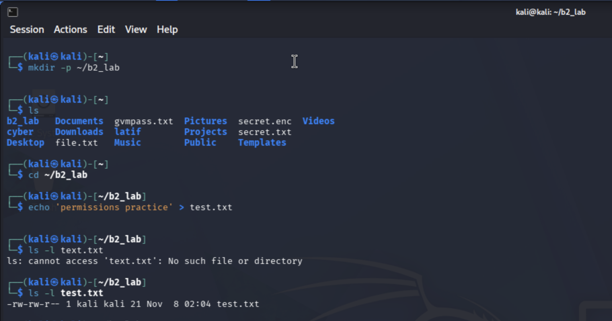
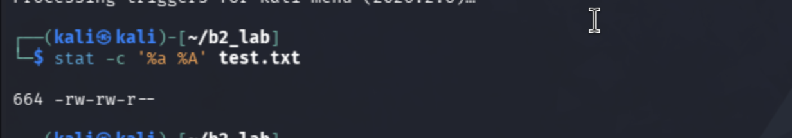
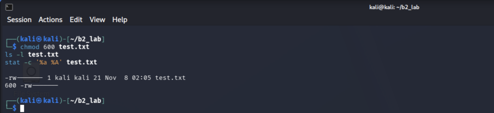
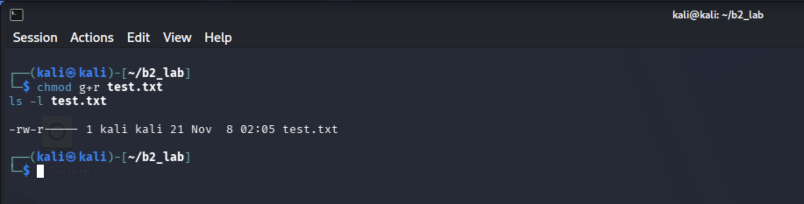
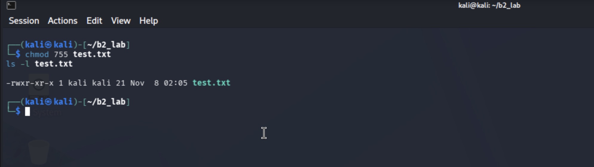
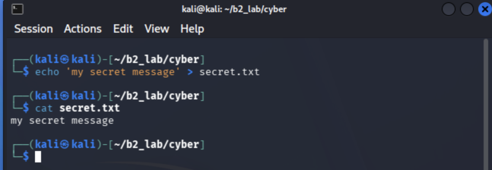
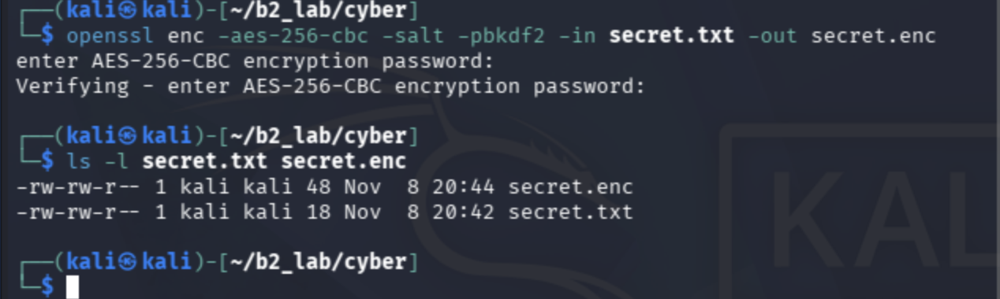
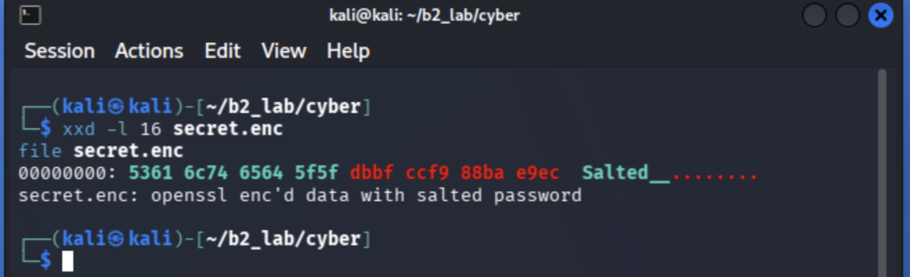
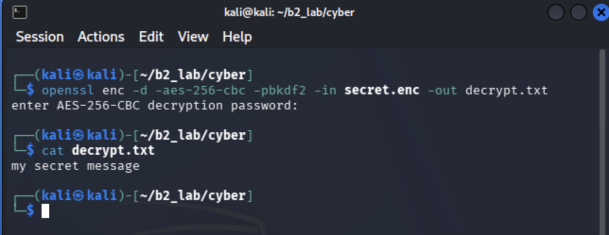

# S01 Foundations: Malware Types, Linux Permissions and OpenSSL Encryption

**Programme:** Digital Forensic & Cyber Security
**Student name:** Muhammad Latif
**Cohort:** PSEB-CYBER-ISB-02
**ID:** TRN-2026-000445

## Overview

This submission covers three parts of the S01 Foundations practical:

- **Task A:** a research table of 12 malware types with definitions, real-world examples, how they spread, their impact and sources.
- **Task B2:** a Linux file permissions lab using `chmod` in octal and symbolic modes.
- **Task B4:** encrypting a file with OpenSSL and examining the `Salted__` header with `xxd`.

The full report is in [S01_Research_Malware.pdf](S01_Research_Malware.pdf).

## Task A: Malware Types and Examples

| Type | Example (year) |
|---|---|
| Virus | Ping-Pong (1988) |
| Worm | Morris Worm (1988) |
| Trojan | Zeus (2007) |
| Ransomware | WannaCry (2017) |
| Spyware | Pegasus (2016) |
| Adware | Fireball (2017) |
| Rootkit | Sony BMG copy protection rootkit (2005) |
| Keylogger | Agent Tesla (2014) |
| Botnet agent | Mirai (2016) |
| Fileless / living-off-the-land | Astaroth (2018) |
| Logic bomb | Omega Engineering logic bomb (1996) |
| Bootkit | TDL4 (2011) |

**Most dangerous for a Pakistani SME:** ransomware, because it can encrypt important business data, interrupt daily operations and cause major financial loss, while SMEs often have limited security budgets. Recommended defences are updated antivirus software, strong passwords, regular backups, staff training and multi-factor authentication.

The full table, with definitions, how each type spreads, primary impact and source links, is in the report PDF.

## Task B2: Linux File Permissions

**Goal:** create a file, change its permissions three times (mixing symbolic and octal modes), and explain each change.

```bash
mkdir -p ~/b2_lab
cd ~/b2_lab
echo 'permissions practice' > test.txt
ls -l test.txt
stat -c '%a %A' test.txt
```

The three octal digits are owner, group and other. Each digit is the sum of read (4), write (2) and execute (1).


*Figure 1: Creating b2_lab and test.txt, then listing it with ls -l*


*Figure 2: Starting permissions: 664 (-rw-rw-r--)*

| Step | Command | Octal | Symbolic result | What changed |
|---|---|---|---|---|
| Start | `echo > test.txt` | 664 | `-rw-rw-r--` | Owner read/write, group read/write, others read |
| 1 | `chmod 600 test.txt` | 600 | `-rw-------` | Owner read/write, group none, others none |
| 2 | `chmod g+r test.txt` | 640 | `-rw-r-----` | Owner read/write, group read, others none |
| 3 | `chmod 755 test.txt` | 755 | `-rwxr-xr-x` | Owner read/write/execute, group read/execute, others read/execute |


*Figure 3: chmod 600 (octal)*


*Figure 4: chmod g+r (symbolic)*


*Figure 5: chmod 755 (octal)*

## Task B4: Encrypt with OpenSSL and Decode the Header with xxd

**Goal:** encrypt a file, look at the first 16 bytes, and explain `Salted__`.

**Step 1: Create a secret file**

```bash
mkdir -p ~/cyber && cd ~/cyber
echo 'my secret message' > secret.txt
cat secret.txt
```


*Figure 6: Creating secret.txt*

**Step 2: Encrypt**

```bash
openssl enc -aes-256-cbc -salt -pbkdf2 -in secret.txt -out secret.enc
ls -l secret.txt secret.enc
```


*Figure 7: Encrypting with AES-256-CBC (18 bytes becomes 48 bytes)*

**Step 3: Look inside**

```bash
xxd -l 16 secret.enc
file secret.enc
```


*Figure 8: The first 16 bytes of secret.enc*

The first 8 bytes spell the text `Salted__`, a header OpenSSL writes to show the file was encrypted with a salted password. The next 8 bytes are the random salt, which is combined with the password to derive the key. The remaining 32 bytes are the encrypted data.

**Step 4: Decrypt to prove it works**

```bash
openssl enc -d -aes-256-cbc -pbkdf2 -in secret.enc -out decrypt.txt
cat decrypt.txt
```


*Figure 9: Decryption restores the original message*

## Repository Structure

```
S01 Foundations/
├── Figure/
│   ├── lab-01-01.png
│   ├── lab-01-02.png
│   ├── lab-01-03.png
│   ├── lab-01-04.png
│   ├── lab-01-05.png
│   ├── lab-01-06.png
│   ├── lab-01-07.png
│   ├── lab-01-08.png
│   └── lab-01-09.png
├── S01_Research_Malware.pdf
└── README.md
```