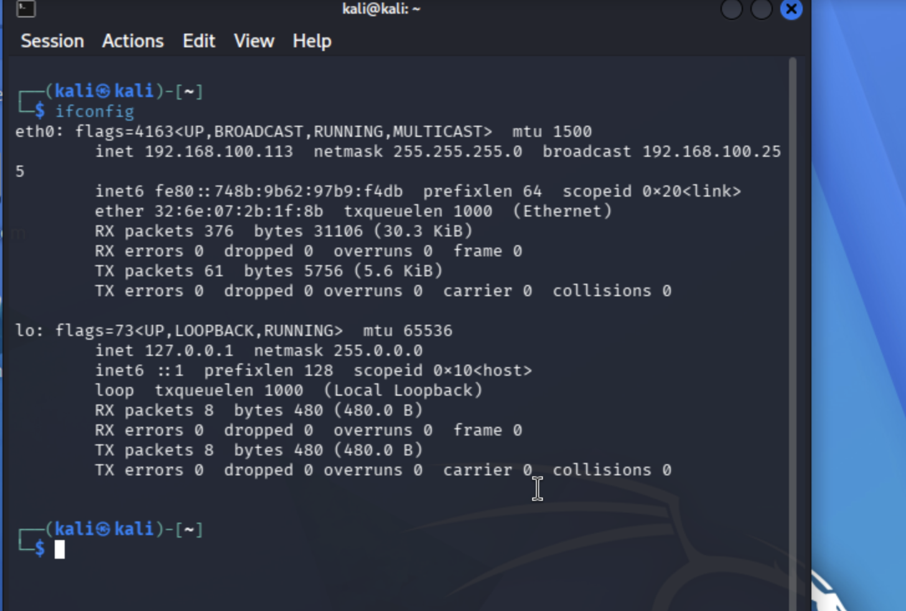
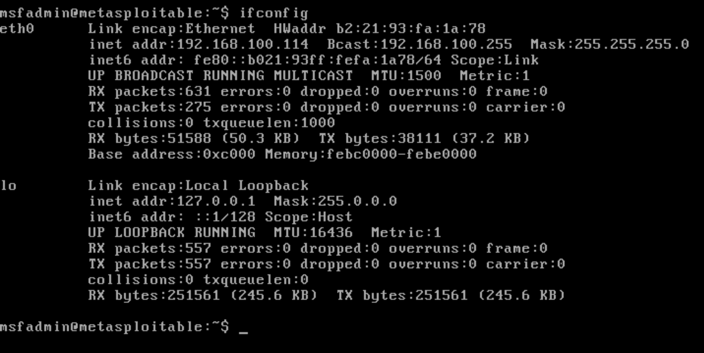
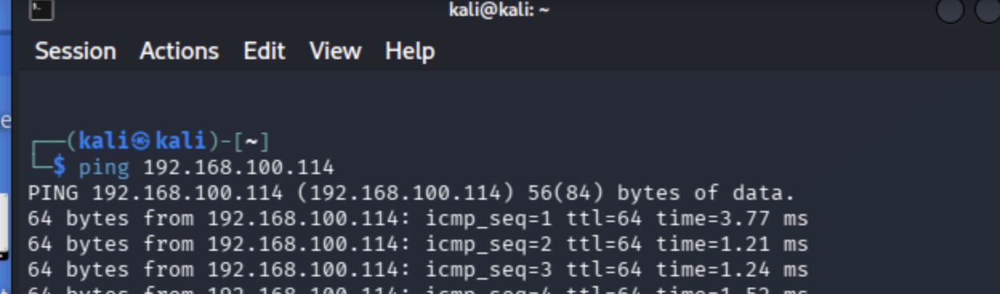
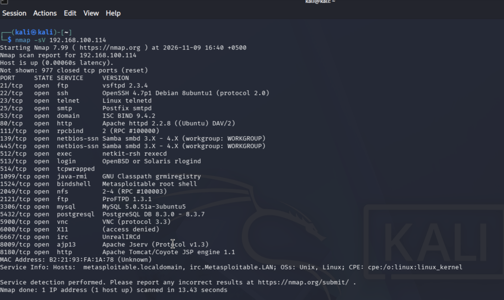
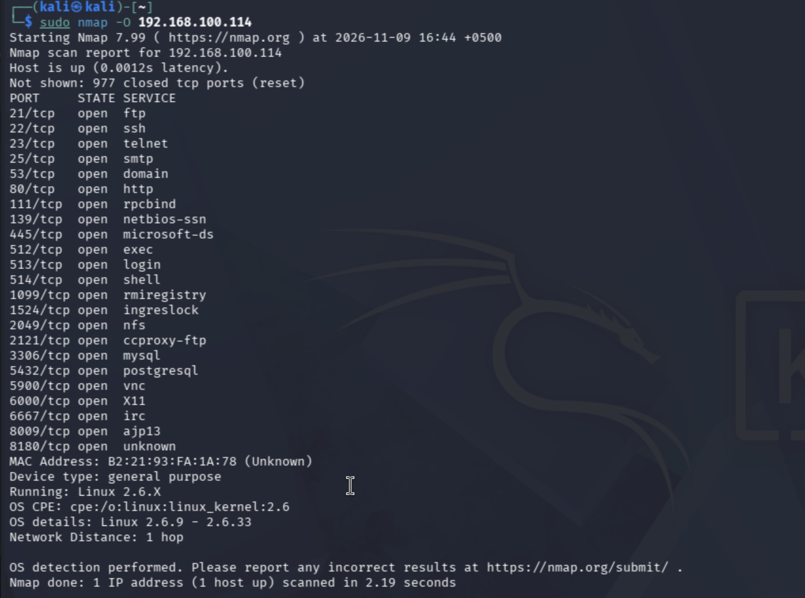
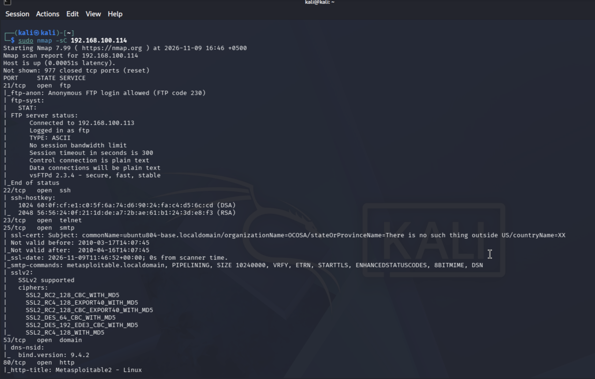
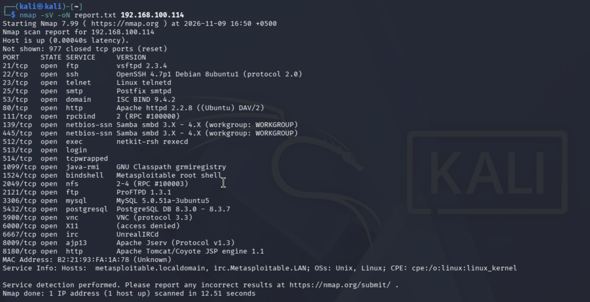
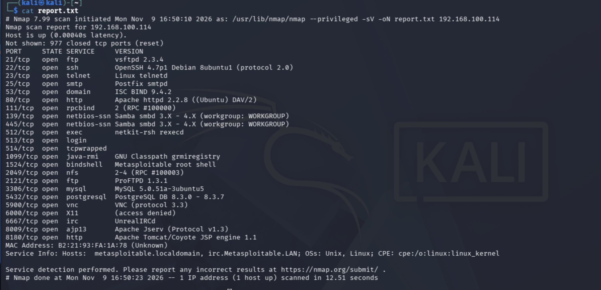
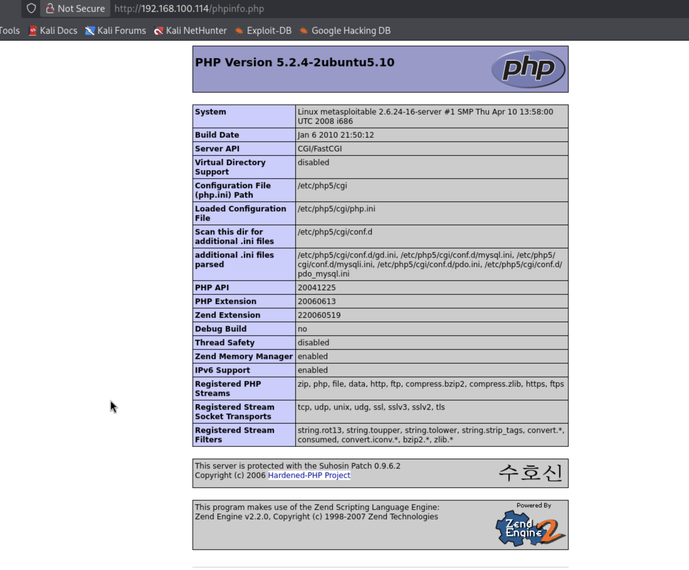
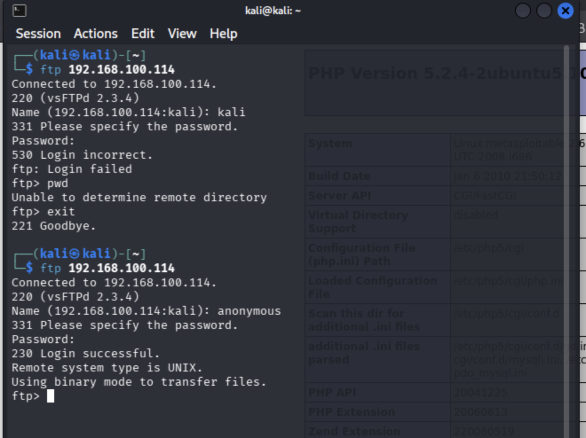

# S06 Lab: Network Scanning and Vulnerability Assessment

**Programme:** Digital Forensic & Cyber Security
**Student name:** Muhammad Latif
**Cohort:** PSEB-CYBER-ISB-02
**ID:** TRN-2026-000445
**Date of practical:** 9 November 2026

## Overview

This lab scans a deliberately vulnerable virtual machine (Metasploitable 2) from Kali Linux using Nmap. The goal is to check that the target is reachable, find open ports, detect services and versions, and record the vulnerabilities found.

> All testing was done in an isolated lab network, on a machine built to be vulnerable, for learning purposes only.

## Objectives

- Verify that the target system is reachable.
- Identify open ports.
- Detect running services and versions.
- Perform basic service enumeration.
- Generate an Nmap report.

## Lab Environment

| Item | Value |
|---|---|
| Attacker machine | Kali Linux (192.168.100.113) |
| Target machine | Metasploitable 2 (192.168.100.114) |
| Tool | Nmap 7.99 |
| Scope | Single target host 192.168.100.114 |

## Commands Used

| Step | Command | Purpose |
|---|---|---|
| 1 | `ifconfig` | Show IP address, MAC address and network settings |
| 2 | `ping 192.168.100.114` | Check that the target is reachable |
| 3 | `nmap -sV 192.168.100.114` | Detect services and versions |
| 4 | `sudo nmap -O 192.168.100.114` | Detect the operating system |
| 5 | `sudo nmap -sC 192.168.100.114` | Run default scripts for basic enumeration |
| 6 | `nmap -sV -oN report.txt 192.168.100.114` | Save the scan results to a text file |
| 7 | `curl -I http://192.168.100.114/phpinfo.php` | Request HTTP headers of the phpinfo page |
| 8 | `ftp 192.168.100.114` | Test FTP login (normal user and anonymous) |

## Results and Evidence

### 1. Connectivity check


*Figure 1: ifconfig on Kali Linux (192.168.100.113)*


*Figure 2: ifconfig on Metasploitable 2 (192.168.100.114)*


*Figure 3: Successful ping replies from the target*

### 2. Nmap scans


*Figure 4: Service version detection (23 open ports)*


*Figure 5: OS detection (Linux 2.6.9 - 2.6.33)*


*Figure 6: Default script results*


*Figure 7: Saving the scan to report.txt*


*Figure 8: Contents of report.txt*

### 3. Manual checks


*Figure 9: phpinfo.php page exposing PHP 5.2.4 and server details*


*Figure 10: FTP login: user "kali" rejected, "anonymous" accepted*

## Summary of Findings

| ID | Finding | Port | Severity |
|---|---|---|---|
| F-01 | vsftpd 2.3.4 backdoor (CVE-2011-2523) | 21/tcp | Critical |
| F-02 | phpinfo.php information disclosure | 80/tcp | Low to Medium |
| F-03 | Anonymous FTP access | 21/tcp | Medium |
| F-04 | Root shell service exposed | 1524/tcp | High |
| F-05 | Weak SSLv2 and expired certificate on SMTP | 25/tcp | Medium |

## Additional Tasks

- **Task B3: CVSS scoring** of CVE-2011-2523 (CVSS 3.1 vector `AV:N/AC:L/PR:N/UI:N/S:U/C:H/I:H/A:H`, base score 9.8). Notes: [evidence/task-b3-cvss-notes.md](evidence/task-b3-cvss-notes.md)
- **Task B6: vsftpd supply-chain compromise** (2011 backdoored download). Notes: [evidence/task-b6-vsftpd-supply-chain.md](evidence/task-b6-vsftpd-supply-chain.md)

## Conclusion

The target has a very high level of exposure, mainly because of the backdoored vsftpd 2.3.4, an exposed root shell service, anonymous FTP, an exposed phpinfo page, and weak SSLv2 on SMTP. The main fixes are to remove or upgrade vulnerable software, close unneeded services, disable anonymous FTP, and use modern TLS.

## Repository Structure

```
digital-forensic-cyber-security-pseb-bootcamp/
└── s06-network-scanning/
    ├── README.md
    ├── S06_Network_Scanning_Lab_Report.docx
    └── evidence/
        ├── figure-01-ifconfig-kali.png
        ├── figure-02-ifconfig-target.png
        ├── figure-03-ping.png
        ├── figure-04-nmap-sV.png
        ├── figure-05-nmap-O.png
        ├── figure-06-nmap-sC.png
        ├── figure-07-nmap-oN.png
        ├── figure-08-cat-report.png
        ├── figure-09-phpinfo.png
        ├── figure-10-ftp-anonymous.png
        ├── report.txt
        ├── task-b3-cvss-notes.md
        └── task-b6-vsftpd-supply-chain.md
```

## References

- NIST NVD, CVE-2011-2523: https://nvd.nist.gov/vuln/detail/CVE-2011-2523
- FIRST, CVSS v3.1 Specification: https://www.first.org/cvss/v3.1/specification-document
- FIRST, CVSS v2 Guide: https://www.first.org/cvss/v2/guide
- Chris Evans, Alert: vsftpd download backdoored (2011): https://scarybeastsecurity.blogspot.com/2011/07/alert-vsftpd-download-backdoored.html
- The Register, Popular FTP package download tarball poisoned (2011): https://www.theregister.com/security/2011/07/05/popular_ftp_package_download_tarball_poisoned/